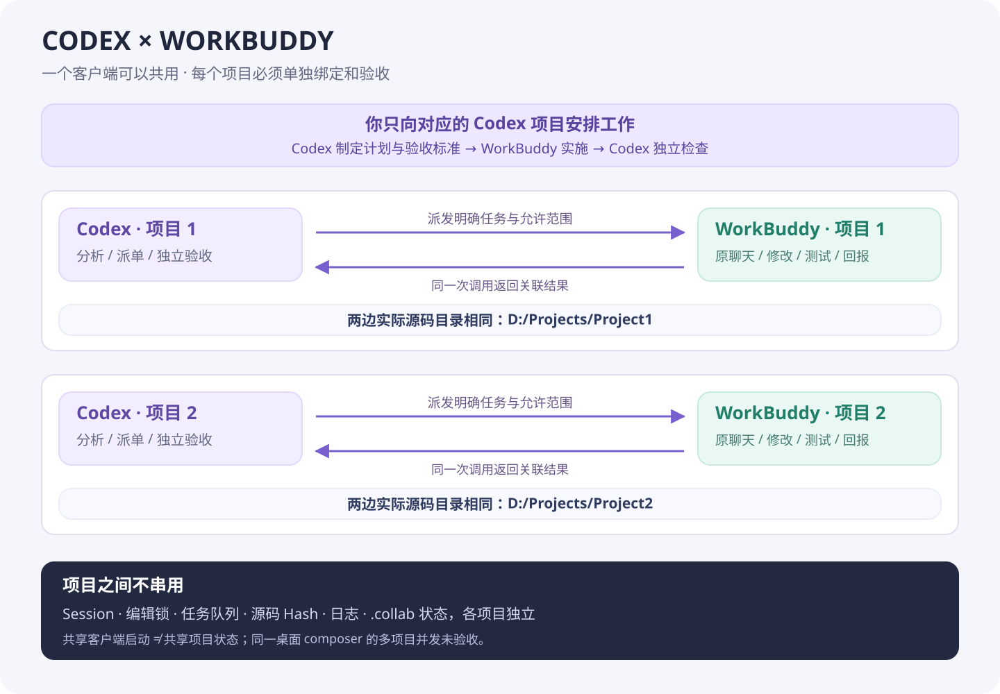
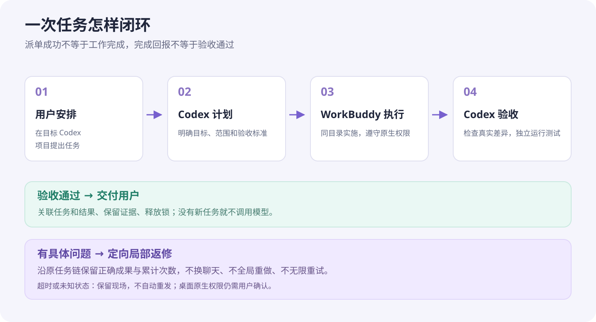

# Codex × WorkBuddy

让 Codex 安排工作，WorkBuddy 在同一项目目录执行，Codex 独立验收。

> **本仓库是迁移参考基线，不是安装器。** 它提供冻结脱敏的参考源码、逐文件迁移契约、配置模板与说明文档，帮助你在**自己的某一个项目**里，让本机 Codex 与 WorkBuddy 桌面版的**原聊天**按「Codex 计划 → WorkBuddy 执行 → Codex 独立验收」协作。仓库内没有任何可一键运行的部署脚本，也没有任何真实项目目录、会话 ID、安装 Hash、协作状态或密钥。

## 一、用来做什么

在一个项目里，Codex 负责检查现状、制定带修改范围与验收标准的计划，WorkBuddy 在**同一个物理目录**内按限定范围实施并交回实际差异，Codex 再独立核验。两端通过项目专属的协作 CLI 交换 `sync / ack / begin / finish / message` 交接，用 `task.*` 派单、`result.*` 回报并以 `reply_to` 关联；一次任务的结果沿**同一次 MCP 调用**返回，不需要第二次唤醒。

它适合：已经有本机 Codex 与 WorkBuddy 桌面版工作流、希望把「派单—执行—验收」固定成可审计流程、并且愿意逐项目做适配与真实往返验收的开发者。

## 二、功能与使用条件

| 项目 | 说明 |
|---|---|
| 通用一键安装器 | 每个项目都要逐文件适配标识、路径、Hook、源码扫描范围，并做真实往返验收；见 [docs/MIGRATION.zh-CN.md](docs/MIGRATION.zh-CN.md) |
| 全版本兼容 | 参考基线仅在 **Windows + WorkBuddy Desktop 5.9.3 + Python 3.12+** 的参考副本上验证过；其他客户端/SDK 版本需重新验证，不继承结论 |
| 多项目并发 | **多个项目同时操作同一个桌面 composer 的并发能力未实现、未验收**；共享的只是客户端启动器，不共享编辑锁 |
| 空闲时派单 | 客户端及本机入口已就绪、原聊天空闲且权限符合条件时，由 Codex 的真实派单触发执行；双方都没有新任务时，不调用模型轮询或保活。应用任意方式启动即自动可用未验收 |
| 参考源码 | `reference/` 是冻结脱敏的**对照源码**，不含运行配置；`.collab/`、`.work/`、虚拟环境、SQLite、`.env` 均被 `.gitignore` 排除 |
| 项目验收 | 目标项目必须自己完成绑定、握手、单次真实修改与独立验收；`workbuddy_route_verified` 初始为 `false` |

## 三、核心原则：一个 Codex 项目对应一个 WorkBuddy 项目



- **项目 1 的 Codex ↔ 项目 1 的 WorkBuddy 原聊天**，两端指向**同一个物理目录**（如 `D:/Projects/Project1`）；项目 2 是另一套完全独立的绑定，指向 `D:/Projects/Project2`。不串项目、不串目录、不靠窗口标题判断。
- 每个项目各自独立持有：项目标识与 MCP 别名、两端真实会话绑定、编辑锁、协作状态库（`.collab/state.sqlite`）、源码 Hash、权限策略、通知与交接记录。
- **绝不直接复制 `.collab/`、状态库、会话 ID、`verified` 或历史投递记录**到新项目；新项目的配置一律新建，`verified` 初始为 `false`。
- 客户端可以只启动一次（统一启动器仅管理 exe / 安装 Hash / 回环端口），但**启动锁 ≠ 项目编辑锁 ≠ 跨项目派单锁**。



第一次使用先读[客户端启动说明](docs/CLIENT_STARTUP.zh-CN.md)。本仓库没有依赖作者机器上的统一启动器路径。

## 四、安装前提

| 项 | 要求 |
|---|---|
| 操作系统 | Windows（基线验证环境）；需要可用的 Node 以跑 JS 行为测试 |
| 客户端 | WorkBuddy 桌面版，基线为 5.9.3；官方签名安装，需在安装所在机器重新计算 exe SHA256 |
| Python | 3.12+（用到 `Path.is_junction`）；参考依赖见 `requirements-reference.txt`（`mcp 2.3.0` / `httpx 0.28.1` / `websockets 16.1.1`） |
| 两端会话 | 目标项目**真实**的 Codex 会话 UUID 与 WorkBuddy 原聊天 UUID，均来自宿主实际回执；不要照抄文档、不要随机生成 |
| 权限 | 目标项目的**明确用户授权**；宿主需真实信任项目 Hooks；默认权限模式保持原生，不用 `fullAccess` 代替确认 |
| 目录 | 两端使用同一个真实物理目录，拒绝符号链接 / junction 越界 |

## 五、仓库结构

```text
codex-workbuddy/
├── README.md                      本文件
├── CONTRIBUTING.md                贡献与变更约束
├── SECURITY.md                    安全与脱敏边界
├── THIRD_PARTY_NOTICES.md         上游来源与许可状态（务必先读）
├── CHANGELOG.md                   版本记录
├── .gitignore                     排除运行态与凭据
├── SOURCE_MANIFEST.json           参考源码逐文件 SHA256 与基线标识
├── requirements-reference.txt     参考依赖版本（非业务依赖清单）
├── docs/
│   ├── MIGRATION.zh-CN.md         逐文件迁移契约与必须保留的运行契约
│   ├── QUICKSTART.zh-CN.md        分步上手（含占位符命令示例）
│   ├── ARCHITECTURE.zh-CN.md      链路、状态与同调用回报
│   └── TROUBLESHOOTING.zh-CN.md   error / offline / busy / unknown 等状态
├── assets/
│   ├── project-pairing.mmd        一一对应关系（Mermaid 源）
│   ├── project-pairing.svg        一一对应关系（原创配图）
│   ├── project-pairing.png        同上 PNG 版
│   └── task-lifecycle.svg         任务生命周期（原创配图）
├── examples/                      全部为占位模板，不可直接执行
│   ├── MCP.template.toml
│   ├── desktop.template.json
│   ├── 项目变量表.template.json
│   └── 旧通道清理盘点.template.csv
└── reference/setup/collaboration/ 冻结脱敏参考源码（23 个文件）
    └── workbuddy_acp_bridge/      含 UPSTREAM.md 来源登记
```

`SOURCE_MANIFEST.json` 是源码版本依据：复制前后逐文件核对 Hash；其中的 `baseline_zip_sha256` 只是历史溯源字段，**对应旧 ZIP 未随本仓库分发，不能作为部署输入**。

## 六、快速上手（摘要）

1. 读 [docs/MIGRATION.zh-CN.md](docs/MIGRATION.zh-CN.md) 第 0–2 节，填好目标项目变量表，**先盘点、备份、隔离**旧尝试；已有状态库不要覆盖或重建。
2. 把 `reference/setup/collaboration/` 按原布局复制到目标项目，核 `SOURCE_MANIFEST.json` 的 Hash，再按迁移契约第 4 节改项目标识、JS/Python 成对键、Python 路径、源码扫描范围与测试引用。
3. 由 `examples/` 模板生成目标项目自己的 `.codex/config.toml` 与 `.collab/desktop.json`（合并保留已有 Hooks / AGENTS / 技能 / 用户设置），所有占位符必须替换。
4. 准备目标项目 Python 环境与依赖；新库才执行 `init`，已有库走兼容检查。
5. 运行目标 `install.py` 生成 Hooks，经宿主**真实信任**；核对编码命令只含目标路径。
6. 两端 `sync → 逐页 ack → begin`，完成原聊天绑定后 `finish`；`status` 核项目、会话、权限与 PID，`verified` 仍为 `false`。
7. 先做一次只读握手，再做一次真实局部修改 + 关联结果，由 Codex 独立验收；最后按项目逐个验证刷新 / 正常重启 / 隔离。

完整命令示例与顺序见 [docs/QUICKSTART.zh-CN.md](docs/QUICKSTART.zh-CN.md)。文档中所有 `D:/Projects/...` 与 `<...>` 都是**虚构占位符**，原样复制不可执行。

## 七、工作方式：计划 → 执行 → 验收

| 角色 | 职责 |
|---|---|
| Codex | 检查工程、制定含目标/范围/保护项/验收的计划，以 `task.*` 派单（绑定当时源码 `tree_hash`）；收到结果后独立核差异、跑测试、判是否返工 |
| WorkBuddy | 核项目与真实会话、比对 `source_tree_hash`，`sync` 读完所有未读页并逐页 `ack`，按冻结 protocol 的精确命令 `receive / begin`，只在授权范围内实施；先写完 `finish` / `result` 记录，再 `finish` 释放锁、`message` 提交唯一 `reply_to` 关联结果，然后停止 |
| 协作层 | 单编辑锁、稳定 `key`、`reply_to` 关联、源码 Hash 扫描、投递状态与通知游标；`ACK` 只是已读，`recipient_received` 只是通知送达，都不等于验收通过 |

`return_mode=same_call`：结果沿原调用返回，**不额外 dispatch 唤醒**；误调用 dispatch 只返回「无需唤醒」，不会产生第二条消息。锁由实际 holder 收尾，另一会话 `blocked` 时只读、不抢锁、不冒用 owner。`unknown` 状态永久保留、禁止重发。

## 八、已知限制与待确认

- 目标 Linux/其他客户端版本、真实付费推理、长时间压力、多项目同 composer 并发均未验收。
- 上游 ACP 桥接代码的**许可证文本未随附**，本仓库不作 MIT 或任何其他许可声明；详见 [THIRD_PARTY_NOTICES.md](THIRD_PARTY_NOTICES.md)。
- 统一启动器只负责启动/复用一个客户端，不代表其他项目已接入，也不授予跨项目权限。
- 本文与配套文档描述的是迁移方法，**不表示任何目标项目已经部署或验收**；[docs/MIGRATION.zh-CN.md](docs/MIGRATION.zh-CN.md) 中运行契约章节属于必须保留的实现约束，不是可自由改写的建议。

## 九、验证参考源码

在仓库根目录、Windows、Python 3.12与Node就绪的环境中执行：

```powershell
py -3.12 -m venv .venv
.\.venv\Scripts\python.exe -m pip install -r requirements-reference.txt
.\.venv\Scripts\python.exe -I -X utf8 -m unittest discover -s reference/setup/collaboration -p "test_*.py" -v
```

参考副本本地独立验证153项通过；这是程序测试，目标项目仍需自己的真实派单验收。详见[验证记录](docs/VALIDATION.zh-CN.md)。

## 十、文档索引

| 文档 | 何时读 |
|---|---|
| [docs/MIGRATION.zh-CN.md](docs/MIGRATION.zh-CN.md) | 动手前必读：变量表、清理顺序、逐文件旧值→新值、运行契约、验收矩阵 |
| [docs/QUICKSTART.zh-CN.md](docs/QUICKSTART.zh-CN.md) | 按步骤执行时 |
| [docs/ARCHITECTURE.zh-CN.md](docs/ARCHITECTURE.zh-CN.md) | 想理解链路与同调用回报时 |
| [docs/TROUBLESHOOTING.zh-CN.md](docs/TROUBLESHOOTING.zh-CN.md) | 遇到 error / offline / busy / unknown 时 |
| [SECURITY.md](SECURITY.md) / [THIRD_PARTY_NOTICES.md](THIRD_PARTY_NOTICES.md) | 公开发布或提交内容前 |
| [CONTRIBUTING.md](CONTRIBUTING.md) / [CHANGELOG.md](CHANGELOG.md) | 参与维护时 |
