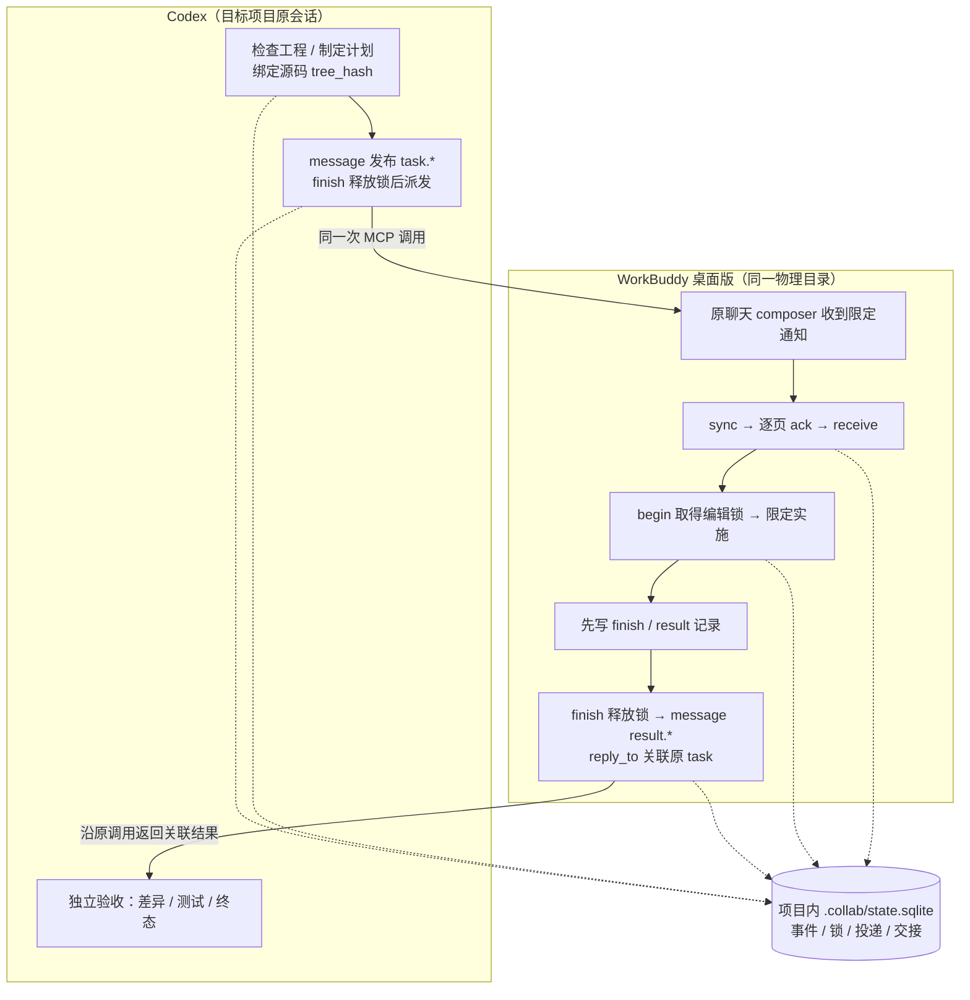
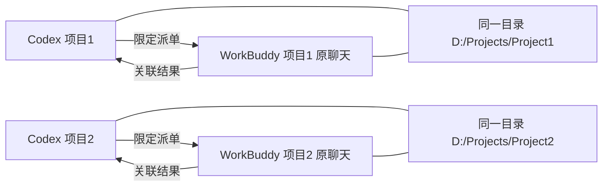

# 架构与调用链

> 本文描述**参考基线**的设计，不表示任何目标项目已部署或验收。仓库内 `reference/setup/collaboration/` 是冻结脱敏的对照源码，逐文件版本依据见根目录 `SOURCE_MANIFEST.json`。

## 一、整体链路（同一次调用返回结果）

`return_mode=same_call`：派发器在同一次调用中等待并收集**唯一**关联结果，再返回给 Codex。WorkBuddy 侧不再 `dispatch` 第二次唤醒；误调用只返回「无需唤醒」，不产生第二条消息。旧路线中「先 finish 再 dispatch 结果 ID」的做法仅适用于旧 `dispatch` 模式，本基线不混用。

## 二、项目配对与隔离

参考 `assets/project-pairing.mmd` / `assets/project-pairing.svg`：

- **一个 Codex 项目 ↔ 一个 WorkBuddy 项目 ↔ 一个物理目录**。项目 1 的会话、绑定、锁、状态库不会指向项目 2。
- 每个项目独立：`desktop.json` 绑定与两端真实会话、项目标识与 MCP 别名、JS `globalThis` key 与事件前缀、编辑锁、`state.sqlite`、`source_tree_hash`、通知游标、权限策略。
- 共享的只有**客户端启动器**（exe / 安装 SHA256 / 回环端口），它不读取项目路径或聊天。**启动锁 ≠ 项目编辑锁 ≠ 全客户端派单锁**；多个项目同时操作同一个桌面 composer 的并发未实现、未验收。
- `state.sqlite` 不跨项目共享、不复制、不重建覆盖；`meta.project_id` 是初始化生成的库 UUID，与逻辑 `PROJECT_ID` 是两种不同标识，不要互相改写。

## 三、协作状态机

| 阶段 | 命令 | 含义 |
|---|---|---|
| 同步 | `sync --agent … --session …` | 返回未读交接、实际文件差异 SHA256、分页 `more`、编辑者与 `ack_token` |
| 已读 | `ack --token 本页token` | 仅确认本页已读；`more=true` 必须继续 `sync`，不能把下一页当已读 |
| 送达 | `receive --event-id … --note-file …` | 用**本轮实际收到的通知正文**登记 `recipient_received`；只证明送达，不代表执行或验收 |
| 编辑 | `begin` | 领取单编辑锁；未读完、有未归属磁盘变化或他人持锁时 `blocked`，此时只读 |
| 实施 | 限定路径 / 精确命令 | 只做本轮明确任务，不扩大授权、不改其他项目 |
| 交接 | `finish --note-file …` | 绑定前后文件 Hash、写交接并释放本会话锁 |
| 回报 | `message --to codex --note-file …` | 提交 `result.*`，以 `reply_to` 关联原 `task.*` |

`ACK` 只是已读；`recipient_received` 只是通知送达；`queued` / `sent_awaiting_ack` 只是传输回执。`independently_accepted` 在回报中始终为 `false`，由 Codex 独立核验后才产生验收结论。

## 四、结果收集的硬条件

派发器沿原调用收集结果时，至少要求：

1. 原生本次请求已到明确终态（`completed` / `error` / `cancelled` 分别处理，终态不等于业务成功）。
2. 绑定原聊天就绪且 `idle`，**无编辑租约**。
3. 原 `task.*` 属于绑定的 Codex 会话；来自绑定 WorkBuddy、`reply_to` 为该 task、`to=codex` 的 `message` **恰好一条**，且 `key` 以 `result.` 开头。
4. 结果事件时间不早于本次局部 Python 开始时间。
5. 满足后写 `result-<ID>.json`、清理本次 current，返回并附 `execution`；`independently_accepted=false`。

**时间单位不统一**：SQLite `events.time`、`lease`、delivery.time 与 `_submit` 局部 `state['started_at']` 为 Python `time.time()` **秒**；JS `started_at/finished_at` 与原生 request `timestamp` 为 `Date.now()` **毫秒**（该安装版本）；`_submit` 的 deadline 用 `time.monotonic()` 秒，仅用于本进程超时。run 文件在被 JS 覆盖后可能含毫秒，`recover` 的秒/毫秒转换不可删除。迁移时详见 `MIGRATION.zh-CN.md` 第 6 节，不得把 JS 字段整体回写局部 state，也不用文件存在 / ACK / idle 代替上述硬条件。

## 五、安全与权限边界

- 所有工具调用使用**绝对路径**；批准的非 helper 命令带固定项目 `cd` 前缀；文件工具拒绝相对路径。
- 任务策略冻结 event、session、源码 Hash、允许路径 / 命令、期限与通知；模型提出新请求不扩大权限。
- 保留宿主原生权限卡，桥接不调用批准或权限切换接口；不用 `allow_always` / `fullAccess` 代替用户确认。
- 只连本机回环；不读取全局聊天、用户级凭据或其他项目；不新建 / 清空 / 接管会话，不调用第二个模型保活。
- 源码扫描只走白名单目录与扩展名，跳过 `.work/`、`.collab/`、私有目录、素材与归档；保存路径 / Hash / 大小，不保存源码内容或聊天。

## 六、未覆盖的能力

客户端入口就绪、原聊天空闲且权限满足时，Codex的明确派单可以触发执行；任意快捷方式启动即连上、所有权限弹窗路径、其他客户端版本、跨机与多项目composer并发仍须单独验证。本仓库没有常驻守护进程、没有轮询模型、没有云端服务。
